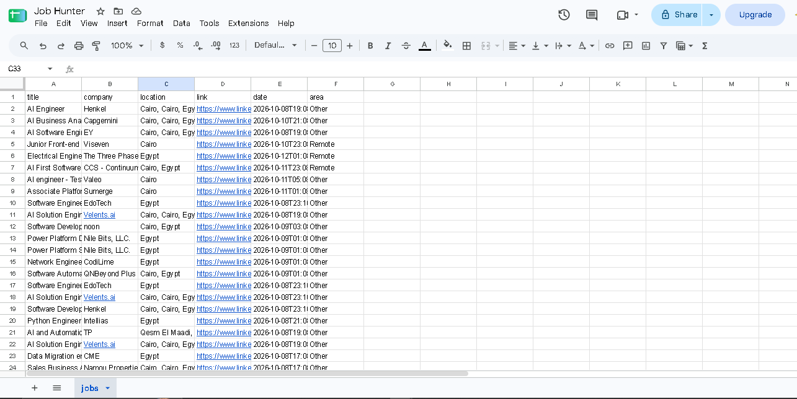
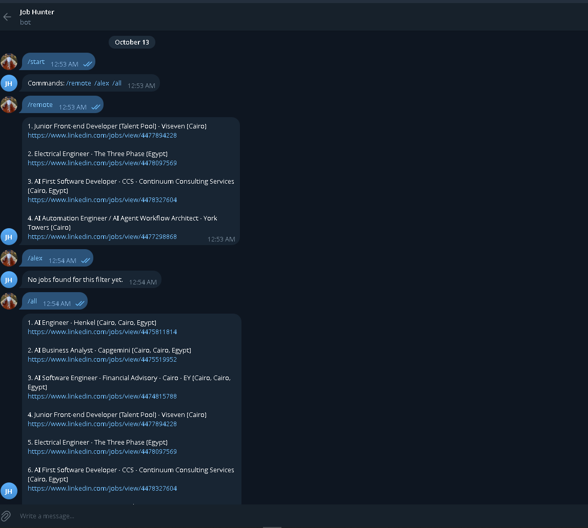

# Job Hunter Bot

An n8n automation that collects job postings from my LinkedIn Job Alert emails, filters out senior roles, stores the rest in a Google Sheet without duplicates, and lets me query them from Telegram (`/remote`, `/alex`, `/all`).

Built as a learning project while moving into AI automation. Everything runs on my own machine (n8n on Docker), with no paid services.

## How it works

The project is three n8n workflows. Their JSON exports are in [`workflows/`](workflows/).

| Workflow | What it does |
|---|---|
| **Job Hunter Bot** | Run manually. Reads the last 15 emails from LinkedIn Job Alerts, extracts every job from each email, drops senior-level titles, and writes the rest to Google Sheets. |
| **Telegram Commands** | Listens for messages to the bot, reads the Sheet, and replies with matching jobs. |
| **Error Handler** | Set as the error workflow for the others. Sends me a Telegram message if a workflow fails. |

### Job Hunter Bot

```
Manual Trigger -> Get Emails (Gmail) -> Extract Jobs (Code) -> Remove Senior (Filter) -> Save to Sheet
```

- **Get Emails:** fetches up to 15 messages from `jobalerts-noreply@linkedin.com`. Simplify is off so the email body is available.
- **Extract Jobs:** a JavaScript Code node. It finds each `View job:` line in the email text, reads the title, company and location lines above it, and builds a clean job link from the job ID. It also reads the email HTML to detect `(Remote)`.
- **Remove Senior:** drops titles matching `senior`, `principal`, `lead`, `leader`, `manager`, `head of`, `staff` (case-insensitive).
- **Save to Sheet:** `Append or Update Row`, matched on `link`, so running the workflow again never creates duplicate rows.

Sheet columns: `title | company | location | link | date | area`

`area` is `Alexandria`, `Remote` or `Other`.

### Telegram Commands

```
Telegram Trigger -> Read Jobs (Google Sheets) -> Build Reply (Code) -> Send Reply (Telegram)
```

| Command | Result |
|---|---|
| `/remote` | Jobs with `area = Remote` |
| `/alex` | Jobs with `area = Alexandria` |
| `/all` | All jobs |
| anything else | List of available commands |

Replies show up to 10 jobs (Telegram limits message length).

### Error Handler

```
Error Trigger -> Notify Error (Telegram)
```

The message includes the workflow name, the node that failed, and the error text.

## Setup

**Requirements:** n8n (I run it on Docker), a Google account, a Telegram account, and a public HTTPS URL for the Telegram webhook (I use ngrok).

1. Create LinkedIn Job Alerts for the roles you want, with email notifications turned on.
2. Create a Google Sheet with a tab named `jobs` and the columns listed above.
3. Create a Telegram bot with `@BotFather` and keep the token inside n8n credentials only.
4. In n8n, create credentials for Gmail, Google Sheets and Telegram. Self-hosted n8n needs its own Google OAuth client (Google Cloud Console).
5. Import the three JSON files from `workflows/`.
6. Replace the placeholders:
   - `YOUR_SHEET_ID` in the Google Sheets nodes
   - `YOUR_CHAT_ID` in `Error Handler`
7. In **Job Hunter Bot** settings, set `Error Workflow` to `Error Handler`.
8. Publish `Telegram Commands` and keep the public URL running while you use the bot.
9. Run **Job Hunter Bot** manually with `Execute workflow` whenever you want to refresh the Sheet.

## Known limitations

- **Remote detection depends on the email.** `Remote` is only set when LinkedIn writes `(Remote)` next to the job in the alert email. A remote job without it is classified as `Other`.
- **Manual run.** I run the collection workflow by hand because my laptop is not on 24/7. Scheduling it needs an always-on server.
- **Title filter is keyword-based.** It can remove a non-senior job that contains one of the keywords (for example a sales role with "Lead" in the title).
- **Email formats.** The extraction is built around the LinkedIn alert email layouts I received. If LinkedIn changes the layout, jobs may not be extracted.
- **Reply limit.** The bot returns the first 10 matches only.

## Screenshots

**Job Hunter Bot**


**Telegram Commands**


**Error Handler**


**Google Sheet**



**Bot replies in Telegram**



